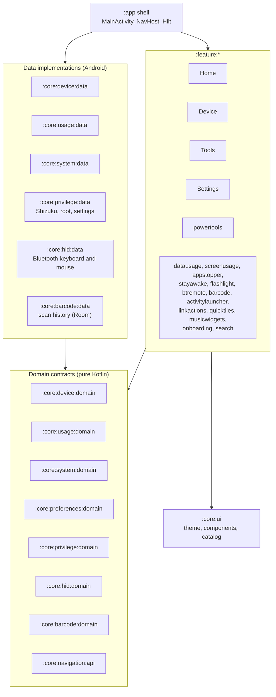

# Osyster - Developer Documentation

> How Osyster is built: modules, data flow, the power tools layer, the design system, and how to test and ship it.

**Version:** 0.3.0 | **Last Updated:** 2026-09-29

---

## Contents

- [Overview](#overview)
- [Toolchain](#toolchain)
- [Modules](#modules)
- [Startup and Navigation](#startup-and-navigation)
- [Device Data](#device-data)
- [Usage Data](#usage-data)
- [System Controls](#system-controls)
- [Power Tools Layer](#power-tools-layer)
- [Bluetooth Remote](#bluetooth-remote)
- [Barcode Scanner](#barcode-scanner)
- [Preferences, First Run, and Backup](#preferences-first-run-and-backup)
- [Widgets, Tiles, Shortcuts, and the Notification Listener](#widgets-tiles-shortcuts-and-the-notification-listener)
- [UI System](#ui-system)
- [Rules the Code Follows](#rules-the-code-follows)
- [Testing](#testing)
- [Build and Release](#build-and-release)
- [Troubleshooting](#troubleshooting)
- [Maintenance](#maintenance)

---

## Overview

Osyster is a single-activity Jetpack Compose app split into 29 Gradle modules. Features own their screens and ViewModels and talk only to domain contracts; data modules implement those contracts; the app shell is the only place that knows every feature.



### Key decisions

- **Privacy is structural.** No `INTERNET` permission, no AccessibilityService, no hidden APIs, and no permanent identifiers. Features that would need any of these (per-app volume, Bluetooth batteries, the Data SIM tile, per-app night light) were dropped rather than bent.
- **Availability, never fake zeros.** Every device value is an `Availability<T>`: available with its source, permission required, unsupported, or restricted. The UI renders each state honestly.
- **Features never depend on features.** A feature emits a neutral destination (`HomeDestination.Tool`, `PowerToolsDestination.Setup`); only the shell maps it to a route or a system screen. Widgets and tiles open tools through `DeepLinks.EXTRA_OPEN_TOOL` on the launch intent, so they never reference the activity class.
- **Power tools are optional and visible.** They unlock with a one-time ADB grant, Shizuku, or root, and every command goes through one quoted command builder.
- **One theme layer.** Material 3 Expressive, Roboto Flex, wallpaper colors by default with presets, all from `:core:ui`.

## Toolchain

| Tool | Version |
|---|---|
| Android Gradle Plugin | 9.5.0 |
| Gradle | 9.8.2 |
| Kotlin | 2.4.21 |
| KSP | 2.3.12 |
| Compose BOM | 2026.09.00 |
| Material 3 | 1.5.0-beta02 (Expressive APIs) |
| Navigation Compose | 2.10.2 (type-safe routes) |
| Hilt | 2.60.1 |
| DataStore | 1.2.1 |
| Coroutines | 1.11.0 |
| MaterialKolor | 5.0.1 |
| Shizuku API | 13.1.5 |
| ArchUnit (tests) | 1.5.1 |
| compileSdk / targetSdk / minSdk | 37 / 37 / 26 |
| JVM target | 11 |

All versions live in `osyster-app/gradle/libs.versions.toml`. Modules may not declare repositories (`FAIL_ON_PROJECT_REPOS`).

## Modules

```text
osyster-app/
  app/                         Shell: MainActivity, OsysterAppShell (NavHost + floating toolbar),
                               SystemActions, launcher shortcuts, backup and first-run stores
  core/
    runtime/                   AppDispatchers, runCatchingCancellable
    navigation/api/            Routes (@Serializable), Tool and ToolGroup, DeepLinks
    device/domain|data/        Device pages, live summary, sensors, device report
    usage/domain|data/         Data usage, screen usage, app stopper list
    system/domain|data/        Stay awake, torch, activities, link handlers, flashlight pulse
    preferences/domain/        Settings backup and first-run contracts
    privilege/domain|data/     Privileged shell (Shizuku, root), settings store, power apps,
                               power tools store, quiet launch
    hid/domain|data/           Bluetooth remote: HID descriptor and reports, layouts, touchpad
                               math, PC actions; Android HID device, scanner, remote settings
    barcode/domain|data/       Barcode scanner: code content and actions (ZXing), search sites;
                               Room history and search sites, scanner settings
    ui/                        Theme, components, destination catalog and help, formatting
  feature/
    home/ device/ tools/ settings/
    datausage/ screenusage/ appstopper/
    stayawake/ flashlight/ btremote/ barcode/ activitylauncher/ linkactions/
    quicktiles/ musicwidgets/ onboarding/ search/ powertools/
```

Domain and API modules are pure Kotlin JVM modules. Data modules are Android libraries with Hilt bindings. Feature modules depend on `:core:runtime`, `:core:navigation:api`, `:core:ui`, and domain modules only.

## Startup and Navigation

1. `OsysterApplication` (Hilt) publishes dynamic launcher shortcuts.
2. `MainActivity` keeps the splash screen until theme options load (two second ceiling), reads `EXTRA_OPEN_TOOL` from the launch intent (and `onNewIntent`), and builds `SystemActions` for things only an activity can do (open URLs, system settings pages, share sheets).
3. `StartGate` wraps the shell. It decides once per launch, from `AppStartRepository`, whether to show the welcome, the "What's new" sheet, or nothing, and draws it over the running app.
4. `OsysterAppShell` hosts a `NavHost` with spring transitions. Navigation 2.10 plays the `predictivePop*` transitions during the back gesture, so those are set to the same springs to keep the gesture continuous.
5. The `FloatingTabBar` shows Home, Tools, and Settings on top-level pages and morphs into a back button with the page title on detail pages. Tabs keep their own back stacks (`saveState` / `restoreState`).

Routes: `HomeRoute`, `ToolsRoute`, `SettingsRoute`, `DevicePageRoute(pageId)`, `ScreenTesterRoute`, `SearchRoute`, `AboutRoute`, `PrivacyRoute`, `LicensesRoute`, one route per utility tool, `WidgetsRoute`, `AppUsageRoute(packageName)` shared by both usage tools, `PowerToolRoute(toolId)` shared by all power tools, and `ToolRoute(toolId)` for tools without a page yet.

On screens 840 dp and wider the shell shows two panes: the tab list on the left in its own NavHost, and pages on the right. One graph builder serves both, and page navigation always goes to the right-hand controller, so features need no changes.

## Device Data

- `DevicePageSource.sections(page)` returns `Flow<List<InfoSection>>`; each section holds `InfoRow`s with a stable key, a label, an `Availability<String>` value, copy and advanced flags, and an optional action (live sensor).
- Collectors read public Android APIs (`Build`, `ActivityManager`, `BatteryManager`, `DisplayManager`, `CameraManager`, `SensorManager`, `ConnectivityManager`, `MediaCodecList`, `MediaDrm` security level only, `KeyStore` CA certificates) plus readable `/proc` and `/sys` files.
- Expensive scans (codecs, certificates, cameras) run on `AppDispatchers.heavy`, a two-thread pool, so they throttle each other.
- `DeviceSummarySource` streams the hero card (CPU load where readable, RAM, battery).
- The device report is plain text and leaves out network addresses, the Wi-Fi name, and long lists.

## Usage Data

- `DataUsageSource` reads `NetworkStatsManager` buckets per day and per app, hourly buckets for single-day reports, any earlier period through an offset, each app's own history through `queryDetailsForUid`, and live rate from `TrafficStats` deltas.
- `ScreenUsageSource` reads `UsageStatsManager` events and folds them into days and hours.
- Both report `UsageAccessState.MISSING` instead of zeros; the screens show `UsageAccessGate` and reload when the app resumes.
- `AppStopperRepository` keeps the managed list and grid size in DataStore and reads Android's stopped and enabled flags, so frozen apps never look uninstalled. Freezing runs through the privileged shell from the App stopper ViewModel.

## System Controls

- **Stay awake:** `StayAwakeService` is a special-use foreground service holding a screen wake lock with a chronometer notification. The timer mode cycles 15 minutes to infinite; the charging mode writes `stay_on_while_plugged_in` with WRITE_SECURE_SETTINGS.
- **Torch:** `TorchControllerImpl` uses `CameraManager` torch callbacks and strength levels on Android 13 and newer.
- **Flashlight pulse:** `PulsePolicy.shouldPulse` (pure, tested) decides; `FlashlightPulseImpl` blinks twice, skipping when the screen is on, the torch is on, the notification is ongoing or from Osyster, or less than four seconds passed.
- **Activities and links:** `AppActivitiesImpl` lists exported activities and pins shortcuts; `LinkHandlersImpl` resolves handlers for a URL with Osyster excluded.

## Power Tools Layer

`:core:privilege` is the only place that runs privileged operations.

- **`PrivilegeStatus`** combines three facts: WRITE_SECURE_SETTINGS granted, `ShizukuState` (not running, unsupported, needs permission, ready), and whether the user turned root on.
- **`PrivilegedShell`** picks Shizuku first, then root. Shizuku runs `ShellUserService` through `Shizuku.bindUserService` and the `IShellService` AIDL interface, in Shizuku's process as the shell user. `@Keep` stops R8 removing it, since nothing in Osyster's process constructs it. Root runs one `su -c` per command; no root shell stays open.
- **`ShellProcess`** drains stdout and stderr on separate threads, kills anything running longer than 30 seconds, and caps output at 512 KB.
- **`ShellCommand.of`** single-quotes every argument. `PackageNames` and `SettingKeys` validate inputs before they reach a command, so a value can never become an extra command.
- **`SystemSettings`** reads through the provider API and falls back to `settings get` when Android 12+ refuses an unreadable key; writes go direct with WRITE_SECURE_SETTINGS and fall back to `settings put` through the shell.
- **`QuietLaunch`** (Shut-Up!) snapshots developer options, USB debugging, and wireless debugging, turns them off in that safe order, and restores exactly the snapshot. The snapshot is committed synchronously so it survives process death.
- **Feature side:** `:feature:powertools` draws Power setup, Power saving, Scale and animations, Status bar icons, System tweaks, Shut-Up!, Standby apps, and Freeze behind one `PowerToolRoute`. Every page extends `PowerViewModel`, which re-reads state whenever a watched setting or the access status changes, and shows an access card instead of failing silently.
- **Tiles:** `PowerTile` checks access first and opens Power setup when it is missing.

## Bluetooth Remote

The phone registers with Android as a Bluetooth HID device (Android 9+), so a TV, computer, or tablet sees a keyboard, mouse, and remote and needs no app. The descriptor and the first three report types are adapted from BT Remote by Atharok (GPLv3).

- **Descriptor (`HidReports`):** five report IDs: remote keys (Consumer page, one 16-bit usage), keyboard (modifiers and one key), mouse (buttons, X, Y, wheel), system control (power down, sleep, wake), and gamepad (16 buttons, hat, two sticks). A host reads the descriptor when it pairs, so a device paired before a descriptor change must pair again before new parts work.
- **Keys are held, not tapped:** the screen sends a press on touch-down and the release on lift, so the host repeats a held key the way a real remote does.
- **Layouts (`RemoteLayout`):** automatic follows the Bluetooth device class (TV, computer, phone); the choice is saved per device by address. `keyboardFor` maps remote keys to keyboard keys on computers (arrows, Enter, Esc, the Windows key), and the ViewModel remembers which kind it held so the release matches.
- **Inputs:** Remote, Touchpad, Keyboard, and Gamepad, saved per device. `PointerAccumulator` keeps fractions so slow moves add up and splits fast moves into reports of at most 127; `ScrollAccumulator` turns finger travel into wheel clicks; `typingChange` turns field edits into Backspace and new keys; `airMouseDelta` turns gyroscope rates into pointer moves with a dead zone.
- **Computer actions (`PcAction`):** shortcuts (Win+L, Win+Print Screen, Ctrl+Shift+Esc, Win+D), the system control keys for sleep and power, and timed Win+X menu sequences for shut down and restart (Windows only).
- **Lifetime:** `RemoteService` is a connected-device foreground service that runs while the remote screen is open or a device is connected, refreshes the remote widget, and offers play, pause, and disconnect in its notification.
- **Privacy:** addresses are used only to connect and to key saved choices, never shown; the store is a DataStore, which backup rules leave out.

## Barcode Scanner

Codes are read on the phone with ZXing; reading and acting on them follows Barcode Scanner by Atharok (GPLv3). Nothing goes online.

- **Camera (`CodeReader`, `CodeAnalyzer`):** CameraX preview through `CameraXViewfinder` and an `ImageAnalysis` that keeps only the latest frame. Only the brightness plane is read, cut to the square drawn on screen and turned to match the screen (ZXing's 1D readers cannot rotate a camera frame themselves). Every image is tried again inverted. After a read the analyzer pauses until the result sheet closes.
- **Pictures:** the photo picker (no storage permission), opened at most 2048 px; a miss is retried at 3/4, 1/2, and 1/4 size, then the Compose crop sheet scans only the framed part.
- **Content (`parseContent`, `actionsFor`):** ZXing's `ResultParser` turns text into links, email, phone, SMS, locations, vCard and MeCard contacts, calendar events, Wi-Fi, products, and ISBNs. Every action is an intent to another app (browser, dialer, Contacts and Calendar insert screens), so no contacts, calendar, or internet permission is needed. Wi-Fi codes show the network and copy the password; Osyster does not join networks.
- **Storage:** scan history and search sites in a Room database (`barcode.db`), excluded from backup; beep and vibrate in a DataStore.
- **Share sheet:** `ShareScanActivity` takes `image/*` shares, reads them over the sharing app, and saves the scan to the history.

## Preferences, First Run, and Backup

- Theme options live in `ThemeSettings` (DataStore) in `:core:ui`; Home layout, app stopper, and tool stores live in their data modules.
- `AppStartRepository` (contract in `:core:preferences:domain`, DataStore in `:app`) records onboarding and the last seen version; `startScreenFor` is pure and tested.
- `SettingsBackup` writes a versioned JSON file (`format: osyster-settings`, `version: 1`) through the Storage Access Framework and refuses files that are not Osyster exports.
- `backup_rules.xml` and `data_extraction_rules.xml` exclude caches and keys; `BackupRulesTest` keeps the two in step.

## Widgets, Tiles, Shortcuts, and the Notification Listener

- **Music widgets:** `OsysterNotificationListener` tracks media sessions; `MusicWidgetUpdater` renders 3x3 and 5x1 RemoteViews with Palette colors; `MusicWidgetControlReceiver` sends transport controls. The same listener feeds flashlight pulse with package name, ongoing flag, and post time only.
- **Data widgets:** today, month, and combined, refreshed on demand and on a schedule.
- **Tiles:** each feature declares its own `TileService`s; the Quick tiles page lists them by class name and offers one-tap add on Android 13 and newer.
- **Shortcuts:** dynamic launcher shortcuts and pinned Shut-Up! shortcuts target `QuietLaunchActivity`, which has no UI.

## UI System

- **Theme:** System, Light, Dark, and Black; wallpaper colors (Android 12+) or a seed preset through MaterialKolor's tonal spot scheme; Roboto Flex everywhere. Black is dark theme passed through `toOled()`, which makes pages (surfaceContainer) pure black and steps rows and raised parts up in small neutral grays. Icon badges switch between pastel circles in light themes and deep tonal circles in dark ones.
- **Charts:** `UsageRing` (split ring with the total inside), `PillBarChart` (stacked, tappable pill bars), `BarChart`, and the hero card's fixed-scale sparkline.
- **Components (`:core:ui`):** `OsysterScaffold` (large collapsing title), `ConnectedGroup` and `ConnectedRow` (rows that touch, rounded only outside), `NavigationRow`, `ToggleRow` with `ExpressiveSwitch`, `ChoiceRow` and `ConnectedChoices` (no radio dialogs), `HeroCard`, `InfoSectionBlock`, `OsysterBottomSheet`, `HelpSheet`, `InlineSearchField`, `EmptyState`, `LoadingState`, `BarChart`, `AppIcon`, `FloatingTabBar`.
- **Catalog:** `DestinationLabel` gives every page and tool one name, summary, and icon; `DestinationHelp` gives the long-press "About this page" text.
- **Motion:** springs (damping 0.75, medium-low stiffness), predictive back, and Reduce motion.
- **Haptics:** `rememberAppHaptics()` for taps, toggles, and long-presses, with a setting to turn them off.
- **Copy:** every string in `strings.xml`, short and plain, no em dashes.

## Rules the Code Follows

1. Features never depend on other features or on concrete data modules.
2. Domain and API modules contain no Android or Compose classes.
3. Data layers take dispatchers from `AppDispatchers`, never `Dispatchers.IO` directly.
4. `runCatchingCancellable` instead of `runCatching` around suspending work.
5. Production UI strings come from resources; contentDescriptions never use string templates.
6. Switches are `ExpressiveSwitch`; choices are connected button groups.
7. Files stay under 700 lines, ViewModels under 500, public composables under 15 parameters.
8. No generic file names (`Models.kt`, `Helpers.kt`, `Utils.kt`, `Contracts.kt`).
9. No `INTERNET` permission, no AccessibilityService, no hidden APIs, no permanent identifiers.
10. Every privileged command is built with `ShellCommand.of` and validated inputs.
11. Values the system hides are shown as unavailable, never as zero.

Rules 1 to 8 are enforced by `ArchitectureBoundaryTest`.

## Testing

Run one Gradle command at a time with `--max-workers=2`, then stop the daemon.

```bash
cd osyster-app
./gradlew :app:testDebugUnitTest --max-workers=2
./gradlew :core:privilege:domain:test :core:system:domain:test :core:preferences:domain:test --max-workers=2
./gradlew :core:hid:domain:test :core:barcode:domain:test --max-workers=2
./gradlew :feature:search:testDebugUnitTest :feature:device:testDebugUnitTest --max-workers=2
./gradlew --stop
```

Test suites cover the architecture rules, backup rule parity, shell quoting and command validation, power policy parsing (standby buckets, battery saver constants, icon blacklist, density), quiet launch ordering and restore, Private DNS cycling and the widget toggle, HID reports and layouts, touchpad and typing math, barcode content parsing, actions, and search templates, stay awake steps, pulse policy, start screen choice, search ranking, inventory search, and device math helpers.

## Build and Release

```bash
cd osyster-app
./gradlew :app:assembleDebug --max-workers=2
./gradlew :app:assembleRelease --max-workers=2
```

- **Version:** `versionCode` is `versionName` without dots (0.2.8 is 28).
- **Outputs:** `Osyster-x.y.z.apk` for release, `Osyster-x.y.z-debug.apk` for debug (`.debug` application ID suffix).
- **Signing:** release signing reads the untracked `signing.properties`, falling back to `local.properties`. Never commit either, or the keystore.
- **Shrinking:** R8 and resource shrinking are on. `proguard-rules.pro` holds only `-dontwarn` lines and line-number attributes; classes created by name use `@Keep`.
- **Verify the certificate** before publishing:

```bash
apksigner verify --print-certs app/build/outputs/apk/release/Osyster-0.2.8.apk
```

## Troubleshooting

- **A value says "Not available":** the phone maker or Android hides it from apps. Check the collector's source field before treating it as a bug.
- **Power tool switches do nothing:** open Power setup. Settings tools need settings access; Freeze, Standby apps, and display size need Shizuku or root while in use.
- **Shizuku shows "Not running" after a reboot:** Shizuku started through wireless debugging must be started again after each reboot.
- **A setting reads as default even after changing it:** Android 12+ blocks reading some keys; without Shizuku or root Osyster cannot read them back.
- **Predictive back looks like a shrinking card:** make sure both `predictivePopEnterTransition` and `predictivePopExitTransition` are set on the NavHost.

## Maintenance

- Update dependencies together, following Arcile's catalog, then rebuild and run the architecture test.
- When adding a tool: add it to `Tool`, its label and help to the catalog, its route to the shell, and its search entry.
- When adding a privileged command: add it to `PowerCommands` with a test.
- CHANGELOG is updated every version; RELEASES only when a version is actually released.

---

Osyster is a solo project. Forks for personal use are welcome under the GPLv3; pull requests are not accepted.
