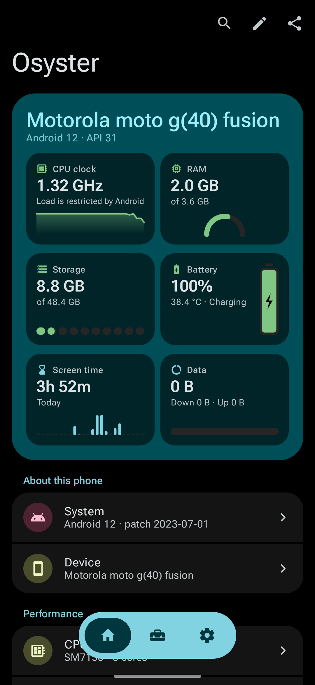
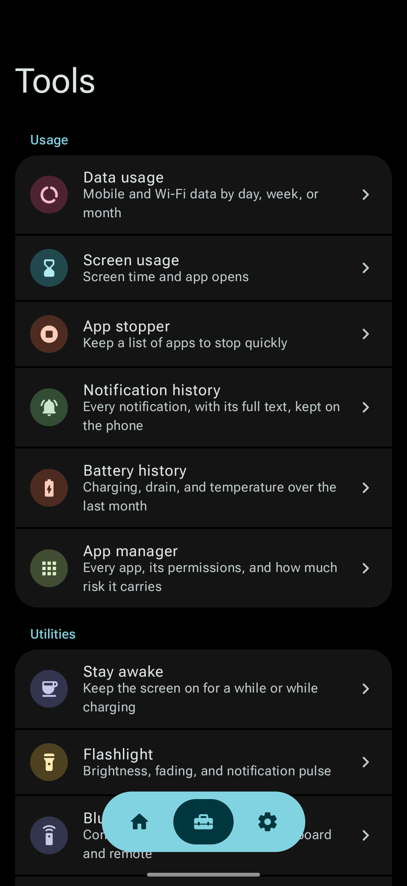
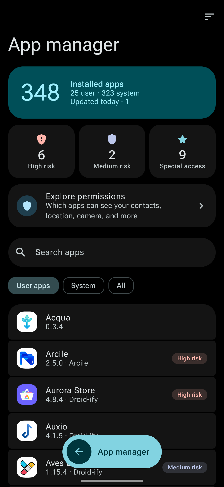
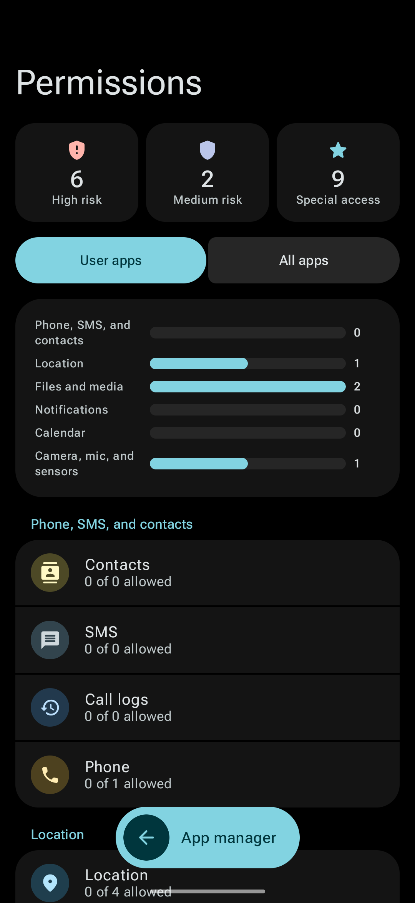
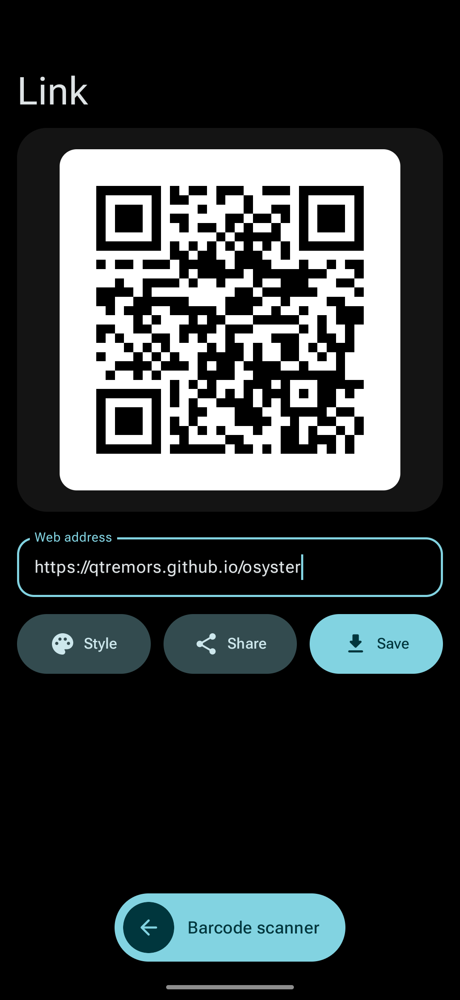
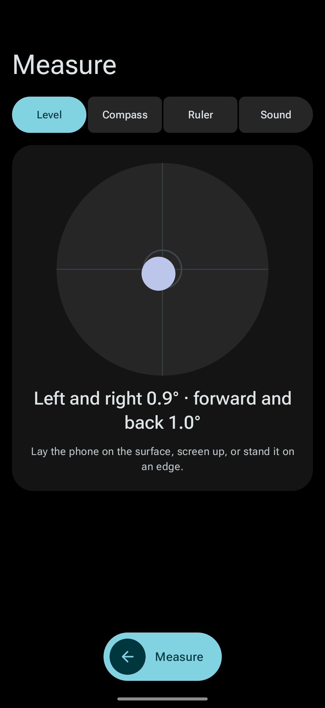

  

<h1 align="center"><a href="https://qtremors.github.io/osyster/">Osyster</a></h1>

  The tools your Android phone should have come with. In one app, offline.

  

  
  

  
  

> [!NOTE]
> **Nothing leaves your phone.** Osyster has no internet permission, so Android itself keeps it offline. No ads, no accounts, no tracking.

## What it is

Osyster shows you what your phone is made of and how you use it, and adds the small tools Android leaves out: a notification history, a battery history, a barcode scanner, a Bluetooth remote, a level and ruler, and more. A few extra tools can change settings Android keeps hidden, if you allow them.

## Screenshots

<table>
  <tr>
    <td></td>
    <td></td>
    <td></td>
  </tr>
  <tr>
    <td align="center">Home</td>
    <td align="center">Tools</td>
    <td align="center">App manager</td>
  </tr>
  <tr>
    <td></td>
    <td></td>
    <td></td>
  </tr>
  <tr>
    <td align="center">Permissions</td>
    <td align="center">Code creator</td>
    <td align="center">Measure</td>
  </tr>
</table>

## Download

Get the latest APK from [GitHub Releases](https://github.com/qtremors/osyster/releases/latest). It runs on Android 8.0 or newer, and you don't need root.

## Features

### Your phone

- **Home:** CPU, memory, storage, battery, screen time, and data at a glance. Pin the tools you use and hide what you don't.
- **Twelve device pages:** system, device, processor, memory, battery, display, cameras, sensors, network, Bluetooth, media, and certificates.
- **Honest numbers:** if Android hides a value, Osyster says so instead of showing a zero.
- **Screen test:** full-screen colors and a touch test.
- **Search:** find any page, tool, setting, or value from Home.
- **Device report:** share a plain-text summary of your phone.

### Tools

- **Data usage:** mobile and Wi-Fi data by day, week, or month, for each app.
- **Screen time:** a week of screen time and how often you open each app.
- **Notification history:** keeps every notification in full, even ones you dismissed or the app deleted. Chats read like a conversation. Off until you turn it on.
- **Battery history:** your battery level over the last month, each charge, drain, and temperature.
- **App manager:** every app with what it's allowed to use, how risky that is, its size, and where it came from. See which apps can use your camera, microphone, location, or contacts.
- **Barcode scanner:** read QR codes and barcodes from the camera or a picture. Make your own and save them as images.
- **Bluetooth remote:** use your phone as a remote, mouse, keyboard, or gamepad for a TV or computer. Nothing to install on the other device. Android 9 or newer.
- **Measure:** a bubble level, compass, ruler, and sound meter.
- **App stopper:** stop the apps you keep closing, all from one grid.
- **Stay awake:** keep the screen on for as long as you choose.
- **Flashlight:** set the brightness (Android 13 or newer), or blink it when a notification arrives.
- **Activity launcher and link actions:** open hidden screens inside apps, and choose which app opens a link.

### On your home screen

- **Widgets:** battery, data usage, a quick summary, and music players that follow only the apps you pick.
- **Quick Settings tiles:** Stay awake, Flashlight, Color picker, Private DNS, USB debugging, and more.
- **Shortcuts:** long-press the icon to scan a code, check data, turn on the flashlight, and more.

### Extra tools (optional)

These change settings Android hides. Allow them once by running one command from a computer, or with [Shizuku](https://shizuku.rikka.app/) or root.

- **Battery saver:** choose what it turns off and when it starts.
- **Display and animations:** animation speed, text size, and display size.
- **Status bar:** hide icons you never look at.
- **System settings:** Private DNS, window blur, tap to wake, and debugging switches.
- **Shut-Up!:** open apps that refuse to run while developer options are on.
- **Freeze and standby:** turn off apps you rarely use, or limit what they do in the background.

### Look and feel

- Colors from your wallpaper, or one of six presets.
- Light, dark, or pure black.
- Two panes on tablets and foldables.
- Back up and restore your settings.

## Community

- Join the [Discord](https://discord.gg/QgUjuNj9U8).
- Report a bug or ask for a feature in [GitHub Issues](https://github.com/qtremors/osyster/issues).
- See what changed in the [changelog](CHANGELOG.md).
- Read the [privacy policy](PRIVACY.md).

## Credits

Built by [Tremors](https://github.com/qtremors), with thanks to:

- [Kotlin](https://kotlinlang.org/), [Jetpack Compose](https://developer.android.com/compose), [Material 3](https://m3.material.io/), and [AndroidX](https://developer.android.com/jetpack/androidx)
- [Hilt](https://dagger.dev/hilt/), [MaterialKolor](https://github.com/jordond/MaterialKolor), and the [Shizuku API](https://github.com/RikkaApps/Shizuku-API)
- [ZXing](https://github.com/zxing/zxing) (Apache 2.0), which reads and draws the codes
- [Roboto Flex](https://fonts.google.com/specimen/Roboto+Flex), the app's font
- [Essentials](https://github.com/sameerasw/essentials) by sameerasw (MIT), which inspired the look
- [BT Remote](https://gitlab.com/Atharok/BtRemote) and [Barcode Scanner](https://gitlab.com/Atharok/BarcodeScanner) by Atharok (GPL-3.0), which the Bluetooth remote and barcode scanner build on
- [Metro](https://github.com/MuntashirAkon/Metro) and [Retro Music Player](https://github.com/h4h13/RetroMusicPlayer) (GPL-3.0), which shaped the round music widget
- [Lucide](https://lucide.dev/) and [Simple Icons](https://simpleicons.org/) for the website icons

Every license is listed in full in the app, under **Settings › About › Open source licenses**.

## For developers

How the app is built, tested, and released: [DEVELOPMENT.md](DEVELOPMENT.md). Open work: [TASKS.md](TASKS.md).

## License

Osyster is free and open source under the [GNU General Public License v3.0](LICENSE.md). You can use, study, change, and share it. If you share a changed version, you must share its source under the same license.

---

  Made by <a href="https://github.com/qtremors">Tremors</a>

